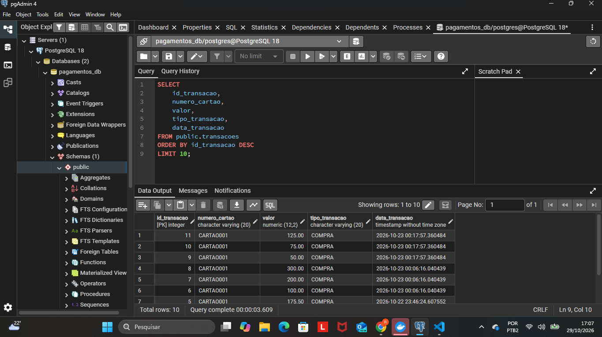
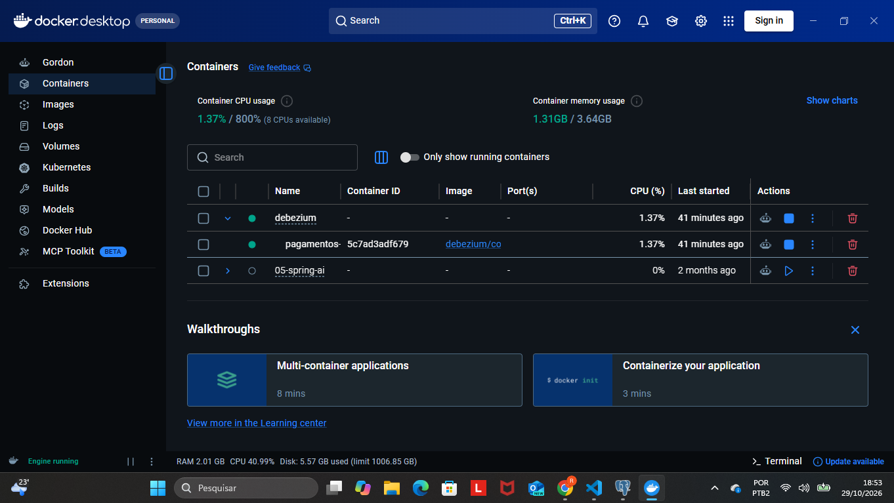
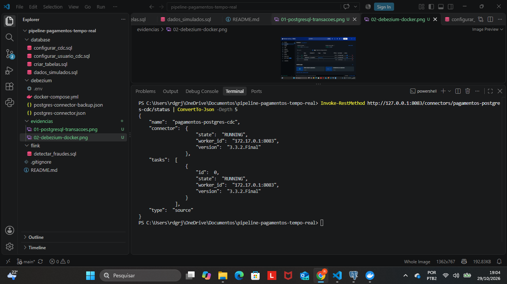
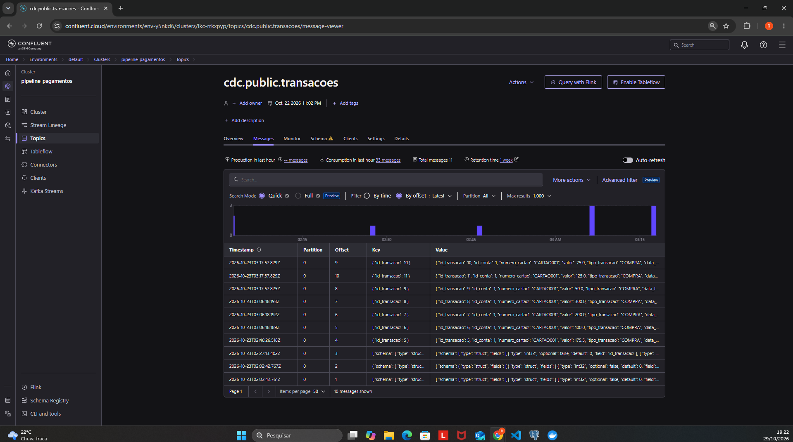
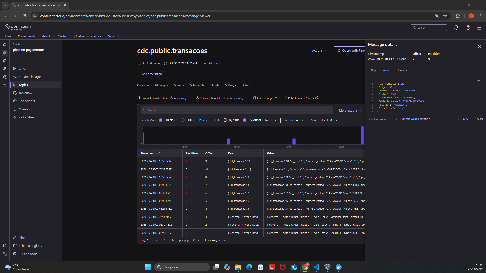
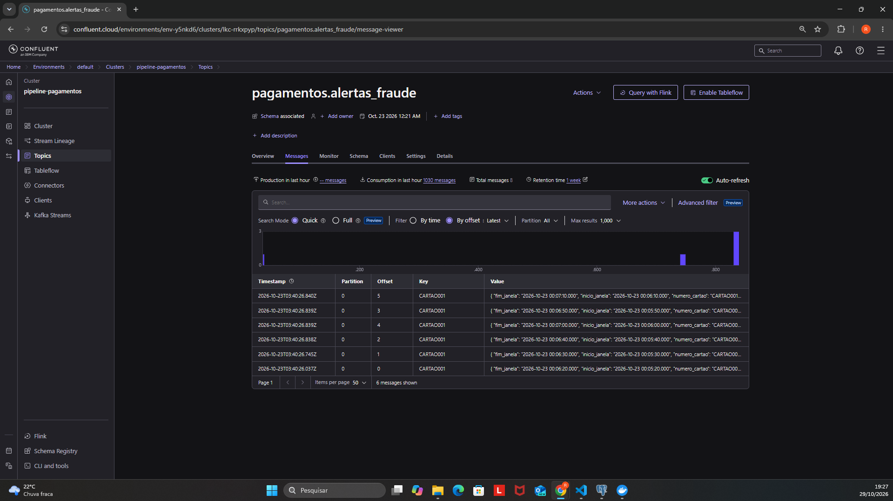
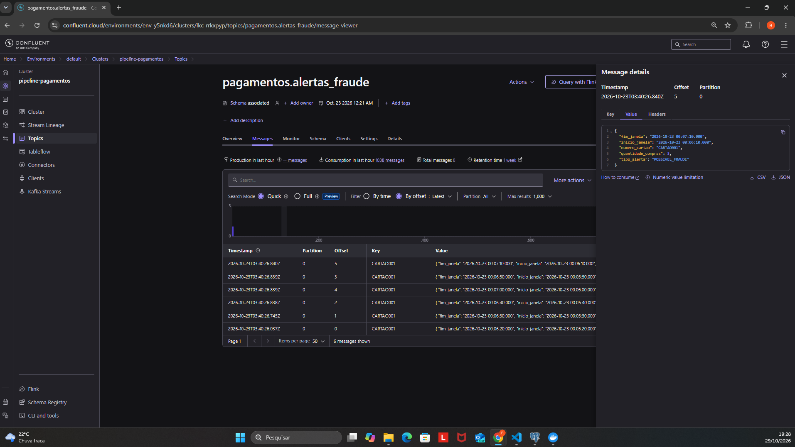
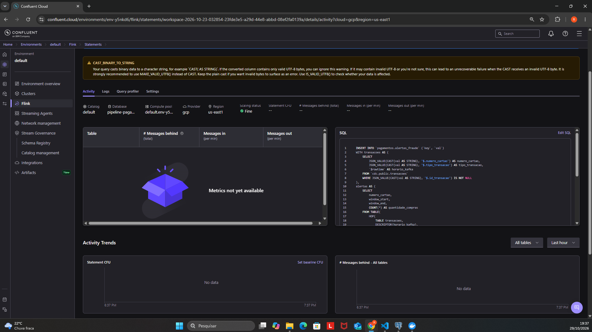
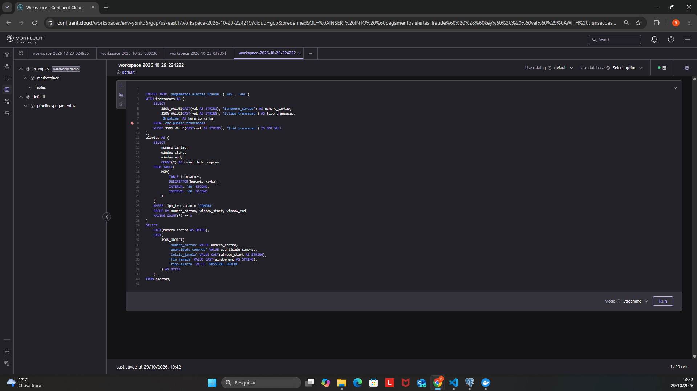

# Pipeline de Pagamentos em Tempo Real

> Pipeline de Engenharia de Dados para captura de transações financeiras, processamento de eventos em tempo real e identificação de padrões de compras potencialmente fraudulentos.

## Visão geral

Este projeto implementa um fluxo de dados que começa no **PostgreSQL**, utiliza **Debezium (CDC)** para capturar alterações, publica eventos no **Apache Kafka (Confluent Cloud)** e processa transações com **Apache Flink SQL**. Quando são detectadas **três ou mais compras com o mesmo cartão em uma janela de 60 segundos**, um alerta é enviado ao tópico `pagamentos.alertas_fraude`.

O projeto foi desenvolvido como protótipo educacional. As transações e os identificadores de cartões utilizados nos testes são fictícios; um alerta indica comportamento suspeito, **não uma fraude confirmada**.

## Objetivos

- Demonstrar o caminho completo do dado, da persistência ao alerta.
- Aplicar **Change Data Capture (CDC)** para transportar alterações sem depender de consultas periódicas em lote.
- Utilizar processamento contínuo com janelas temporais no Flink SQL.
- Documentar configurações, resultados, limitações e evidências para facilitar a avaliação e a reprodução do ambiente.

## Tecnologias e decisões de arquitetura

| Tecnologia | Papel no pipeline | Motivo da escolha |
|---|---|---|
| **PostgreSQL** | Armazena contas e transações | Banco relacional com suporte a replicação lógica |
| **Debezium** | Captura alterações via CDC | Publica mudanças do banco sem polling periódico |
| **Apache Kafka** | Transporta e disponibiliza os eventos | Desacopla a ingestão do processamento e dos consumidores |
| **Confluent Cloud** | Hospeda Kafka e os recursos gerenciados de streaming | Simplifica a operação da infraestrutura durante o protótipo |
| **Apache Flink SQL** | Analisa compras e gera alertas | Permite consultas contínuas e janelas de tempo declarativas |
| **Docker Compose** | Executa o Kafka Connect com Debezium | Padroniza a execução local do conector |
| **Git e GitHub** | Versiona o código e registra as evidências | Facilita auditoria, apresentação e evolução do projeto |

## Arquitetura

```text
                 PostgreSQL (pagamentos_db)
                 ├── public.contas
                 └── public.transacoes
                           │
                           │ Replicação lógica / CDC
                           ▼
                 Debezium / Kafka Connect
                           │
                           ▼
                 Apache Kafka (Confluent Cloud)
                 ├── cdc.public.contas
                 └── cdc.public.transacoes
                           │
                           ▼
                    Apache Flink SQL
                 Regra: >= 3 compras/cartão
                 em 60 s (avanço de 10 s)
                           │
                           ▼
                 pagamentos.alertas_fraude
                           │
                           ▼
                  Consumo / investigação
```

**Escopo implementado:** a regra de fraude demonstrada utiliza os eventos de `cdc.public.transacoes`. Embora o CDC também esteja configurado para a tabela `contas`, **a consulta atual não realiza enriquecimento por JOIN com os dados da conta**. Essa é uma evolução prevista.

## Regra de detecção de possíveis fraudes

O pipeline considera uma sequência suspeita quando ocorrem:

**Três ou mais transações do tipo `COMPRA` com o mesmo `numero_cartao` em uma janela de 60 segundos.**

A consulta utiliza janelas **HOP** de 60 segundos com avanço de 10 segundos, baseadas no horário dos eventos no Kafka (`$rowtime`). Como as janelas se sobrepõem, uma sequência de compras pode gerar mais de um alerta. Portanto, a quantidade de mensagens no tópico de saída não representa necessariamente a quantidade de ocorrências distintas.

### Exemplo de alerta

```json
{
  "numero_cartao": "CARTAO001",
  "quantidade_compras": 3,
  "inicio_janela": "2026-10-23 00:06:10.000",
  "fim_janela": "2026-10-23 00:07:10.000",
  "tipo_alerta": "POSSIVEL_FRAUDE"
}
```

Os valores acima representam dados fictícios utilizados na demonstração.

## Estrutura do repositório

```text
pipeline-pagamentos-tempo-real/
├── database/
│   ├── criar_tabelas.sql
│   ├── configurar_cdc.sql
│   ├── configurar_usuario_cdc.sql
│   └── dados_simulados.sql
├── debezium/
│   ├── docker-compose.yml
│   ├── postgres-connector.json
│   ├── postgres-connector-backup.json
│   └── .env.example
├── flink/
│   └── detectar_fraudes.sql
├── evidencias/
│   ├── 01-postgresql-transacoes.png
│   ├── 02-debezium-docker.png
│   ├── 03-debezium-conector-running.png
│   ├── 04-kafka-transacoes.png
│   ├── 05-kafka-transacao-detalhada.png
│   ├── 06-kafka-alertas-fraude.png
│   ├── 07-alerta-fraude-detalhado.png
│   ├── 08-flink-sql-processamento.png
│   └── 09-flink-sql-codigo-completo.png
├── .gitignore
└── README.md
```

O arquivo `debezium/.env` contém valores locais e **não deve ser versionado**.

## Funcionamento do pipeline

1. O PostgreSQL recebe dados sintéticos nas tabelas de contas e transações.
2. A replicação lógica disponibiliza as alterações para o Debezium.
3. O conector publica os eventos nos tópicos CDC do Kafka.
4. O Flink SQL lê as transações, filtra compras e agrupa os eventos por cartão e janela de tempo.
5. Quando a regra é satisfeita, o Flink publica uma mensagem no tópico `pagamentos.alertas_fraude`.
6. O alerta fica disponível para um consumidor ou processo posterior de investigação.

## Como reproduzir o projeto

> **Pré-requisito importante:** o repositório contém os scripts e as configurações principais, mas o ambiente exige a criação manual de recursos no Confluent Cloud e ajustes locais de rede, permissões e replicação. Os passos abaixo são um guia de reprodução, não uma instalação totalmente automatizada.

### 1. Preparar as ferramentas

Instale **PostgreSQL**, **Docker Desktop** com Docker Compose e **Git**. Tenha uma conta no **Confluent Cloud**, com acesso a Kafka, Schema Registry e Flink SQL. No Windows, habilite o suporte a **host networking** no Docker Desktop caso mantenha a configuração de rede deste projeto.

Clone o repositório:

```powershell
git clone https://github.com/RodrigoSouza4/pipeline-pagamentos-tempo-real.git
cd pipeline-pagamentos-tempo-real
```

### 2. Configurar o PostgreSQL

1. Crie o banco `pagamentos_db`.
2. Habilite a replicação lógica (`wal_level = logical`) e configure os parâmetros de slots, remetentes WAL, autenticação e acesso de rede conforme seu ambiente. Algumas alterações exigem reiniciar o serviço PostgreSQL.
3. Conectado ao banco `pagamentos_db` como administrador, execute os scripts de `database/` na ordem abaixo:
   - `criar_tabelas.sql` — cria as tabelas.
   - `configurar_usuario_cdc.sql` — cria o usuário CDC e concede permissões. **Troque a senha de exemplo antes de executar.** O comando `CREATE ROLE` destina-se à configuração inicial e falha se o usuário já existir.
   - `configurar_cdc.sql` — configura a publicação de replicação.
   - `dados_simulados.sql` — insere os dados de teste.
4. Confirme que o usuário `cdc_user` consegue conectar e ler as tabelas e que a publicação `pagamentos_publication` existe.

**Observação:** os comandos `GRANT` do script de usuário devem ser executados com a conexão estabelecida no banco `pagamentos_db`.

### 3. Preparar o Confluent Cloud

Crie um cluster Kafka e obtenha o endereço de bootstrap. Configure uma conta de serviço e uma chave de API com permissões apropriadas. Para um ambiente com segregação de responsabilidades, utilize identidades distintas para produção e consumo e conceda somente os acessos necessários.

Crie ou configure os tópicos internos do Kafka Connect:

- `pagamentos.connect.configs`
- `pagamentos.connect.offsets`
- `pagamentos.connect.status`

Configure esses tópicos com as políticas adequadas para armazenamento de configurações, offsets e status do Kafka Connect. As propriedades e os fatores de replicação devem ser compatíveis com o cluster escolhido. Garanta as permissões necessárias para os tópicos CDC e para `pagamentos.alertas_fraude`.

Configure o **Schema Registry** e registre os contratos de mensagens aplicáveis ao ambiente. O projeto utilizou mensagens JSON simplificadas na saída do Debezium; a existência de um esquema registrado não significa, por si só, que todas as mensagens estejam sendo validadas automaticamente contra ele.

### 4. Configurar variáveis de ambiente

Na pasta `debezium/`, crie o arquivo `.env` a partir do modelo `.env.example`:

```powershell
cd debezium
Copy-Item .env.example .env
```

Preencha o `.env` local com:

```dotenv
KAFKA_BOOTSTRAP_SERVERS=SEU_BOOTSTRAP_SERVER
KAFKA_API_KEY=SUA_API_KEY
KAFKA_API_SECRET=SUA_API_SECRET
POSTGRES_CDC_PASSWORD=SUA_SENHA_POSTGRESQL
```

**Nunca envie o `.env` para o GitHub.** O `.env.example` contém apenas valores fictícios.

### 5. Iniciar o Debezium

Ainda na pasta `debezium/`, execute:

```powershell
docker compose config --quiet
docker compose up -d
docker ps
```

O `docker-compose.yml` utiliza `network_mode: host`, e o conector aponta para `127.0.0.1:5432`. Esse conjunto depende do suporte a rede do host e de o PostgreSQL estar acessível a partir do contêiner; **não funciona necessariamente sem ajustes em outros sistemas operacionais ou instalações do Docker**.

### 6. Registrar e validar o conector CDC

Com o Kafka Connect disponível na porta `8083`, registre a configuração do arquivo `postgres-connector.json` na API REST. O arquivo do repositório contém o objeto `name` e o objeto `config`, apropriados para a criação do conector por `POST /connectors`.

No PowerShell, a partir da pasta `debezium/`:

```powershell
Invoke-RestMethod `
  -Uri 'http://127.0.0.1:8083/connectors' `
  -Method Post `
  -ContentType 'application/json' `
  -InFile './postgres-connector.json'
```

Se o conector já existir, **não tente criá-lo novamente**. Verifique seu estado:

```powershell
Invoke-RestMethod 'http://127.0.0.1:8083/connectors/pagamentos-postgres-cdc/status' |
  ConvertTo-Json -Depth 5
```

O resultado esperado é `RUNNING` tanto para o conector quanto para sua tarefa. Esse estado foi observado nos testes do projeto.

### 7. Conferir a ingestão no Kafka

No Confluent Cloud, abra o tópico `cdc.public.transacoes` e verifique se os eventos do PostgreSQL chegaram. O conector também está configurado para `public.contas`, com o prefixo de tópicos `cdc`.

Para testes adicionais de **INSERT**, **UPDATE** e **DELETE**, utilize dados fictícios e confira os efeitos no Kafka. **Esses três tipos de operação ainda não estão individualmente comprovados pelas evidências atuais.** A transformação `ExtractNewRecordState` simplifica os eventos e pode alterar a representação de exclusões; consulte a configuração do conector ao interpretar as mensagens.

### 8. Executar o processamento com Flink SQL

No ambiente Flink SQL do Confluent Cloud:

1. Verifique a existência e o formato dos tópicos de entrada e saída.
2. Abra `flink/detectar_fraudes.sql` e confira se a consulta corresponde à versão demonstrada nas evidências, incluindo a escrita em `pagamentos.alertas_fraude`.
3. Execute a consulta com os recursos e as permissões adequados.
4. Insira novas transações sintéticas e acompanhe as mensagens no tópico de alertas.
5. Ao terminar o teste, interrompa a instrução Flink para evitar consumo desnecessário de recursos.

**Nota:** o processamento demonstrado usa uma regra de compras por cartão; não há JOIN com `cdc.public.contas` na versão atual.

## Resultados observados

Durante os testes, foi possível:

- Consultar transações sintéticas persistidas no PostgreSQL.
- Verificar o contêiner Debezium em execução.
- Confirmar o estado `RUNNING` do conector CDC e de sua tarefa.
- Visualizar mensagens de transações no tópico Kafka de entrada.
- Visualizar alertas `POSSIVEL_FRAUDE` publicados no tópico de saída.
- Registrar a consulta Flink SQL utilizada na detecção.

As evidências foram preservadas na pasta [`evidencias/`](./evidencias). As capturas de Flink incluem registros de uma instrução posteriormente interrompida; **não indicam que a consulta continua ativa atualmente**.

## Evidências de funcionamento

### PostgreSQL — dados registrados



### Debezium — contêiner e estado do conector





### Apache Kafka — transações recebidas





### Apache Kafka — alertas de possível fraude





### Apache Flink SQL — consulta e processamento





## Segurança e controle de acesso

- As credenciais do PostgreSQL e do Kafka são fornecidas por variáveis de ambiente.
- O arquivo `.env` não deve ser versionado; o `.env.example` serve apenas como modelo.
- As permissões do usuário CDC devem se limitar ao necessário para replicação e leitura das tabelas autorizadas.
- Em produção, recomenda-se separar identidades de escrita e leitura, utilizar o princípio do menor privilégio e realizar rotação de credenciais.
- Antes de publicar alterações, verifique se não há senhas, tokens ou chaves nos scripts, capturas e no histórico Git.

## Monitoramento, custos e encerramento

Durante a operação, monitore o estado do conector e das tarefas, a chegada de mensagens aos tópicos, as instruções Flink e os indicadores de consumo e faturamento no Confluent Cloud.

**Custo do projeto:** o valor efetivamente cobrado **não foi documentado nesta entrega**. Para registrar um custo real, consulte o painel de faturamento do Confluent Cloud, informe o período dos testes, o consumo e a eventual utilização de créditos gratuitos. Não é correto assumir custo zero apenas por utilizar uma avaliação gratuita.

### Como encerrar

1. Interrompa as instruções Flink que estiverem em execução.
2. Na pasta `debezium/`, pare e remova o contêiner local:

   ```powershell
   docker compose down
   ```

3. Se não houver mais necessidade de manter o ambiente, exclua os recursos de processamento, tópicos e cluster no Confluent Cloud conforme as opções disponíveis na conta. **Confirme antes de excluir:** essas ações podem remover dados e impedir novos testes.
4. Confira o painel de faturamento e verifique se restaram recursos ativos ou cobranças pendentes.
5. O PostgreSQL local pode ser mantido para estudos futuros ou desativado separadamente.

**Atenção:** `docker compose down` interrompe o contêiner local, mas **não encerra nem exclui os recursos gerenciados do Confluent Cloud**.

## Limitações e próximas evoluções

Este projeto é um protótipo educacional e apresenta as seguintes limitações:

- A regra de três compras em 60 segundos sinaliza suspeitas, mas não confirma fraudes.
- Janelas sobrepostas podem gerar múltiplos alertas para a mesma sequência de transações.
- A consulta atual não enriquece as transações com os dados da tabela `contas`.
- Não há evidência individual publicada de INSERT, UPDATE e DELETE, nem demonstração documentada de evolução compatível de esquema no Schema Registry.
- A reprodução depende de configurações externas do PostgreSQL, Docker e Confluent Cloud.
- O custo real do ambiente ainda precisa ser registrado.

**Evoluções possíveis:** adicionar JOIN com dados de contas, criar regras complementares de risco, tratar eventos inválidos em um tópico separado, comprovar a evolução de esquemas e automatizar a preparação do ambiente.

## Autor

Desenvolvido por [RodrigoSouza4](https://github.com/RodrigoSouza4).
